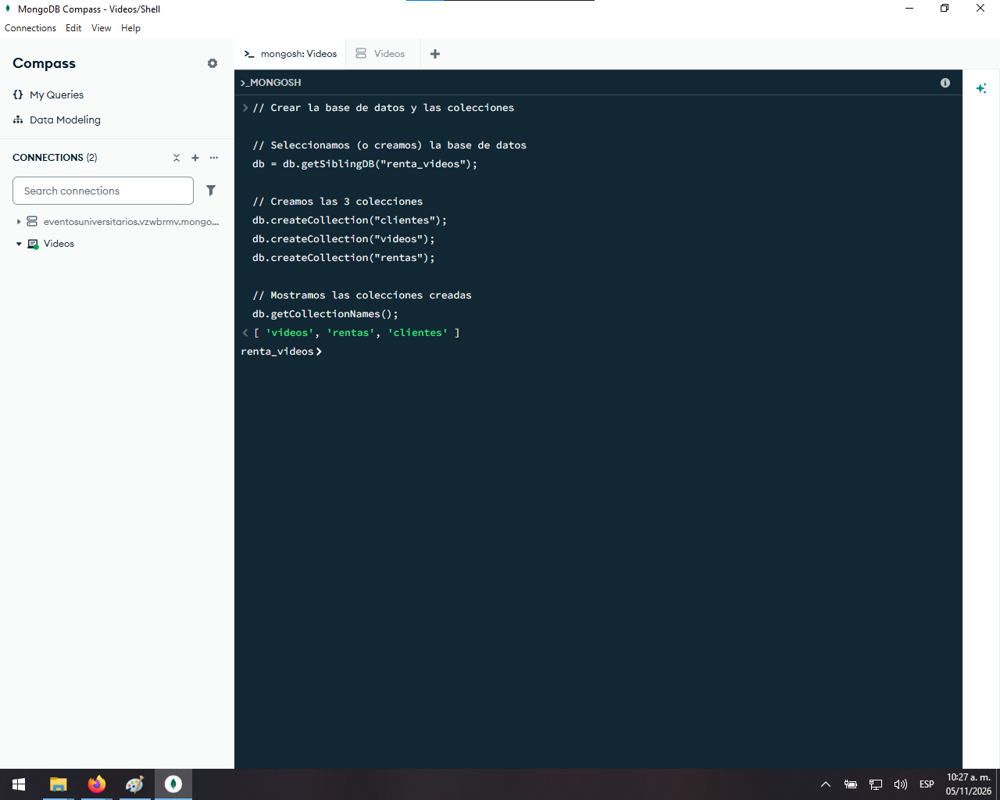
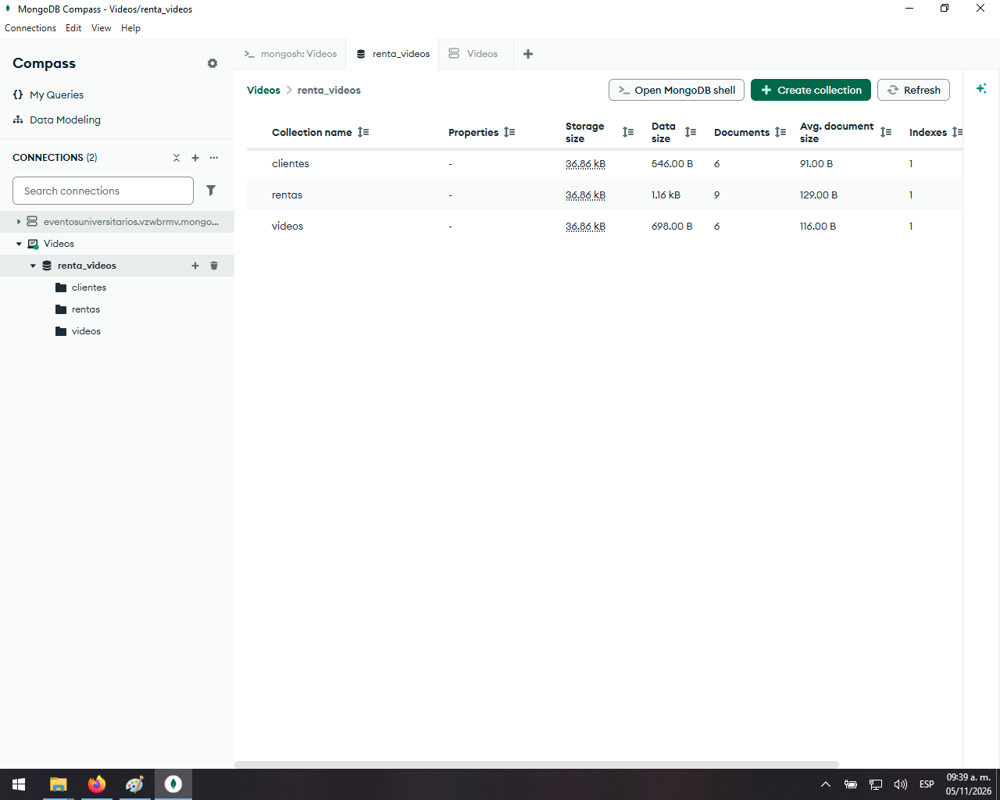
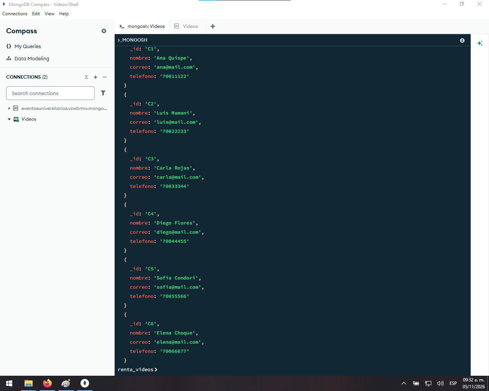
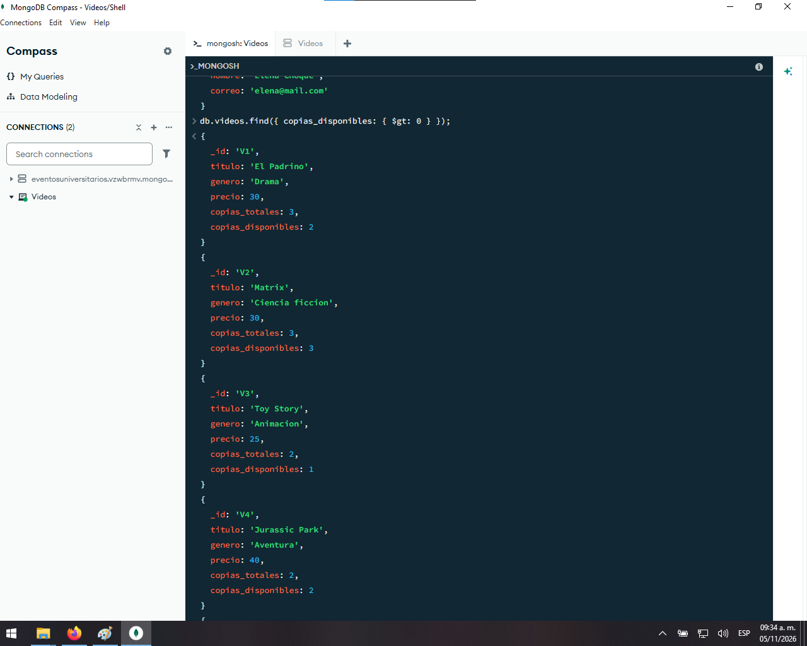
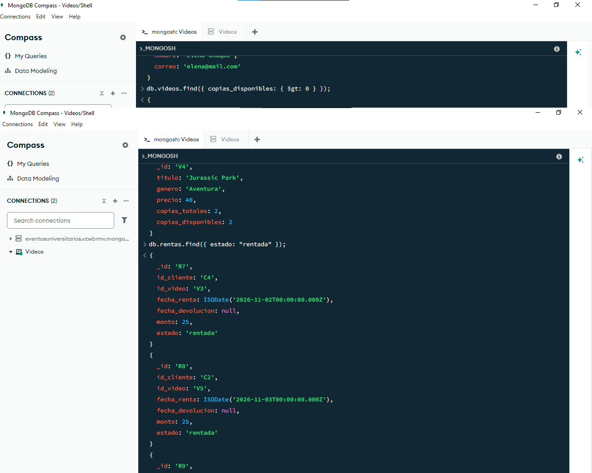
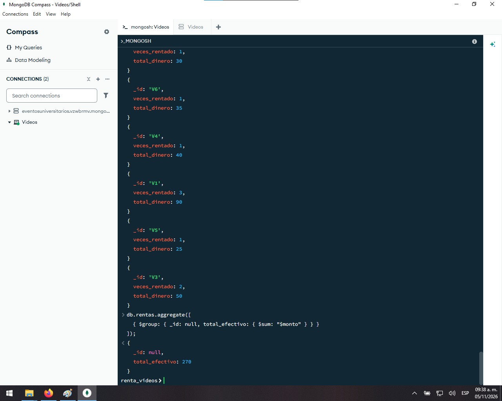

# Renta de Videos - MongoDB

# Estudiantes: 
-Pedro Efrain Rada Saramani

-Cesar Nayib Luis Sumi Urbina

-Claudio Yamil Torrez Calle

-Nicolás Sebastián López Chino

## Descripción

Implementación en MongoDB del problema "Renta de videos" visto en clase, basada en el diagrama de nivel 1 del sistema (clientes, videos, rentas, devoluciones, informes y contabilidad).

## Estructura de la base de datos

La base de datos se llama `renta_videos` y tiene 3 colecciones:

| Colección | Qué guarda | Relación con el diagrama |
|---|---|---|
| `clientes` | Datos de cada cliente | Almacén "1 Cliente" |
| `videos` | Catálogo de videos, precio y copias disponibles | Sistema de adquisición de videos |
| `rentas` | Cliente, video, fecha de renta, fecha de devolución, monto y estado | Procesos 2 (renta) y 5 (devolución) |

Los demás procesos del diagrama se resuelven con consultas:

| Proceso | Consulta |
|---|---|
| 3 - Informe para administración | Consulta 9 (veces rentado y dinero recaudado por video) |
| 4 - Efectivo recibido | Consulta 10 (dinero total recaudado) |
| 6 - Extracto mensual | Consulta 11 |
| 7 - Extracto anual | Consulta 12 |

## Scripts

| Archivo | Para qué sirve |
|---|---|
| `scripts/01_crear.js` | Crea la base de datos y las colecciones |
| `scripts/02_llenar.js` | Inserta clientes, videos y rentas de ejemplo |
| `scripts/03_operaciones.js` | Agrega un cliente, registra una renta y una devolución |
| `scripts/04_consultas.js` | Consultas y reportes |

## Pasos para implementar la base de datos

1. Instalar [MongoDB Community Server](https://www.mongodb.com/try/download/community) y [MongoDB Compass](https://www.mongodb.com/try/download/compass).
2. Clonar o descargar este repositorio.
3. Abrir Compass y conectarse a `mongodb://localhost:27017`.
4. Abrir la consola `>_MONGOSH` (abajo a la izquierda en Compass).
5. Copiar el contenido de `scripts/01_crear.js`, pegarlo en la consola y presionar Enter.
6. Repetir el paso anterior con `02_llenar.js` y luego con `03_operaciones.js`.
7. Para `04_consultas.js`, pegar una consulta a la vez y presionar Enter.
8. Presionar el botón de refrescar en Compass para ver la base de datos `renta_videos`.

> Para volver a empezar desde cero, ejecutar otra vez `01_crear.js` y luego `02_llenar.js`.

## Capturas

### 1. Creación de la base de datos y las colecciones
Se ejecuta `01_crear.js`. Muestra la lista de las 3 colecciones creadas: `clientes`, `videos` y `rentas`.

### 2. Inserción de datos
Se ejecuta `02_llenar.js`. Muestra la cantidad de clientes, videos y rentas insertados.

### 3. Cliente nuevo, renta nueva y devolución
Se ejecuta `03_operaciones.js`. Muestra el alta de un cliente nuevo, el registro de una renta nueva y el registro de una devolución.

### 4. Colecciones en MongoDB Compass
Vista gráfica de la base de datos `renta_videos` con sus colecciones.

### 5. Consulta: ver clientes
Muestra los documentos de la colección `clientes`.

### 6. Consulta: videos con copias disponibles
Muestra los videos que tienen al menos una copia disponible para rentar.

### 7. Consulta: rentas no devueltas
Muestra las rentas con estado `rentada`, es decir, los videos que todavía no se han devuelto.

### 8. Informe para administración: veces rentado y dinero recaudado por video
Agrupa las rentas por video y muestra cuántas veces se rentó cada uno y cuánto dinero generó.

### 9. Efectivo total recibido
Suma el dinero recaudado por todas las rentas.

